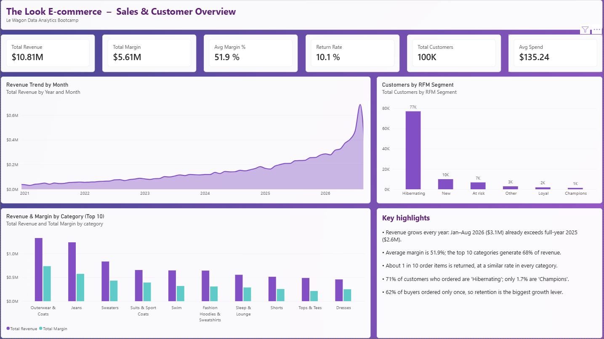
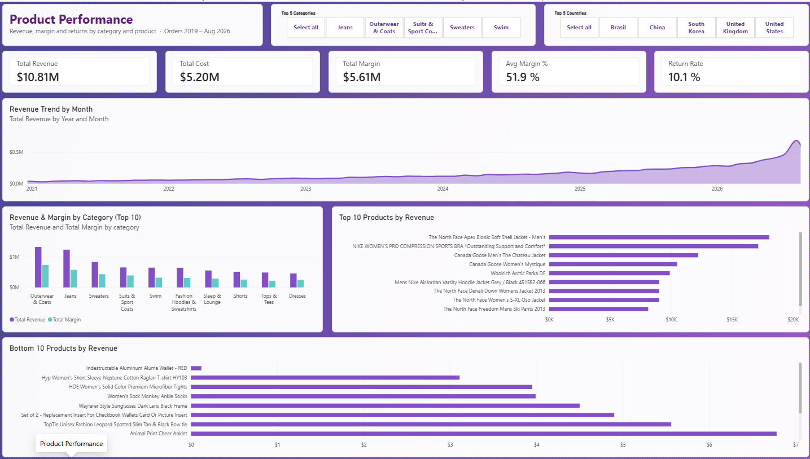
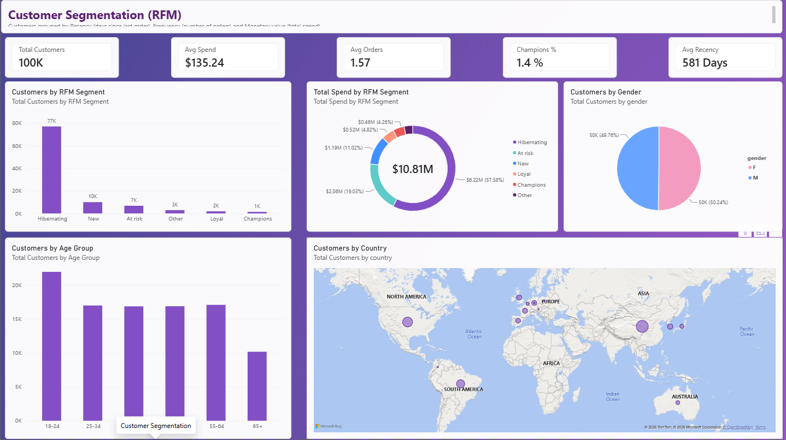
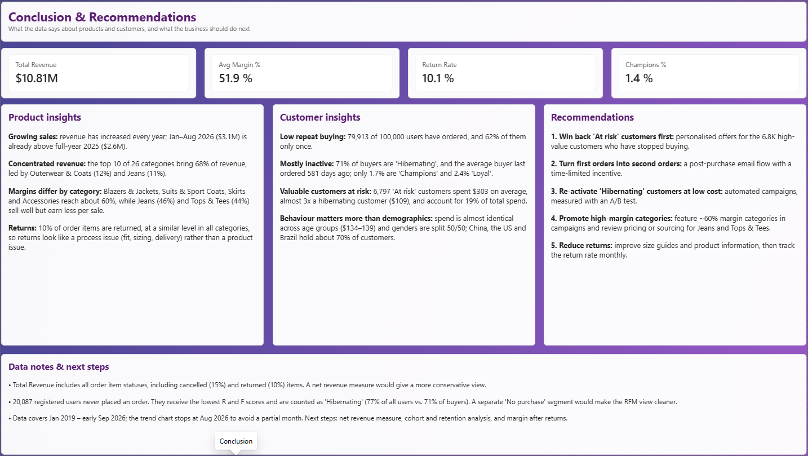

# The Look E-commerce – Sales & Customer Analysis (Power BI)

**Which products drive the business, and which customers should the company focus on to grow?**

A Power BI report on "TheLook", a fictitious online clothing retailer, built from the Google BigQuery public dataset `thelook_ecommerce`. Created as a team project for the [Le Wagon](https://www.lewagon.com/) Data Analytics Bootcamp.



---

## Key findings

**Products**

- **Growing sales:** revenue increased every year. Jan–Aug 2026 ($3.1M) is already above full-year 2025 ($2.6M).
- **Healthy but uneven margins:** the average margin is **51.9%**. Blazers & Jackets, Suits & Sport Coats, Skirts and Accessories reach about 60%, while best-sellers Jeans (46%) and Tops & Tees (44%) earn less per sale.
- **Concentrated revenue:** the top 10 of 26 categories generate **68%** of revenue, led by Outerwear & Coats (12%) and Jeans (11%).
- **Returns:** about **1 in 10** order items is returned, at a similar rate in every category. This points to a process issue (fit, sizing, delivery) rather than a product issue.

**Customers (RFM segmentation)**

- **Low repeat buying:** 79,913 of 100,000 registered users have ordered, and **62%** of them only once.
- **Mostly inactive:** **71%** of buyers are *Hibernating*. Only **1.7%** are *Champions* and 2.4% *Loyal*.
- **High-value customers at risk:** 6,797 *At risk* customers spent **$303** on average, almost 3x a hibernating customer ($109), and account for **19%** of total spend.
- **Behaviour matters more than demographics:** average spend is almost the same across age groups ($134–139), and customers are split 50/50 by gender.

| RFM segment | Customers | Share of buyers | Avg. spend | Share of total spend |
|---|---:|---:|---:|---:|
| Hibernating | 56,967 buyers (+20,087 non-buyers) | 71.3% | $109 | 57.6% |
| New | 9,990 | 12.5% | $119 | 11.0% |
| At risk | 6,797 | 8.5% | $303 | 19.0% |
| Other | 2,917 | 3.7% | $122 | 3.3% |
| Loyal | 1,888 | 2.4% | $276 | 4.8% |
| Champions | 1,354 | 1.7% | $340 | 4.3% |

## Recommendations

1. **Win back *At risk* customers first** with personalised offers. They are the highest-value group that has stopped buying.
2. **Turn first orders into second orders** with a post-purchase email flow and a time-limited incentive.
3. **Re-activate *Hibernating* customers at low cost** with automated campaigns, measured with an A/B test.
4. **Promote high-margin categories** (~60% margin) and review pricing or sourcing for Jeans and Tops & Tees.
5. **Reduce returns** by improving size guides and product information, then track the return rate monthly.

---

## Report pages

| Page | Content |
|---|---|
| **Overview** | KPIs (revenue, margin, margin %, return rate, customers, average spend), monthly revenue trend, RFM segments, revenue & margin by category, key highlights |
| **Product Performance** | Category and country slicers, revenue / cost / margin / return-rate KPIs, revenue trend, top 10 categories, top 10 and bottom 10 products |
| **Customer Segmentation** | RFM KPIs, customers and spend by segment, gender, age group and country |
| **Conclusion** | Product and customer insights, recommendations, data notes |

| Product Performance | Customer Segmentation | Conclusion |
|---|---|---|
|  |  |  |

---

## Data

Google BigQuery public dataset `bigquery-public-data.thelook_ecommerce` (synthetic data), snapshot covering **Jan 2019 – early Sep 2026**.

| Table | Rows | Used for |
|---|---:|---|
| `order_items` | 181,758 | Revenue, cost, returns |
| `orders` | 125,191 | Order dates, order counts |
| `users` | 100,000 | Customer attributes, RFM |
| `products` | 29,120 | Category, cost |
| `inventory_items`, `distribution_centers`, `events` | – | Loaded, not used in the final report |

**Data model:** `order_items` is the fact table, linked many-to-one to `orders`, `products` and `inventory_items`; `orders` links to `users`.

## Approach

1. **Data preparation (Power Query):** loaded the BigQuery tables, checked data types and relationships.
2. **Measures (DAX):** revenue, cost, margin, margin %, return rate and customer KPIs → [`dax/measures.dax`](dax/measures.dax)
3. **RFM segmentation (DAX calculated columns):** for every user, last order date, number of orders and total spend, then R, F and M scores and a segment → [`dax/rfm_calculated_columns.dax`](dax/rfm_calculated_columns.dax)
   - **Recency:** days since the user's last order, scored with fixed thresholds (≤30 days = 5 … >180 days = 1). Fixed thresholds were used instead of `RANKX` because ranking produced many ties.
   - **Frequency:** number of orders (1 to 5+).
   - **Segments:** Champions (R≥4, F≥4), Loyal (R≥3, F≥3), New (R≥4, F≤2), At risk (R≤2, F≥3), Hibernating (R≤2, F≤2), Other.
4. **Report design:** four pages from a high-level overview to detailed analysis and a conclusion, with consistent KPI cards, titles and a shared theme.

## Data notes & limitations

- **Revenue includes all order statuses:** *Total Revenue* sums every order item, including cancelled (15%) and returned (10%) items. A net revenue measure would give a more conservative view.
- **Non-buyers in the RFM model:** 20,087 registered users never ordered. They receive the lowest R and F scores and are counted as *Hibernating* (77% of all users vs. 71% of buyers). A separate "No purchase" segment would make the segmentation cleaner, so the findings above use buyers only.
- **Partial month:** the data ends in early September 2026, so the trend charts stop at August 2026.
- **Synthetic data:** the dataset is generated by Google and refreshed daily, so numbers change if the report is refreshed.

**Next steps:** net revenue measure, separate "No purchase" segment, cohort and retention analysis, margin after returns.

---

## Files

```
├── README.md
├── dax/
│   ├── measures.dax
│   └── rfm_calculated_columns.dax
└── images/
    ├── 01_overview.png
    ├── 02_product_performance.png
    ├── 03_customer_segmentation.png
    └── 04_conclusion.png
```

The `.pbix` file (about 177 MB) is not included because it exceeds GitHub's file size limit.

## Tools

Power BI Desktop · Power Query · DAX · Google BigQuery

---

**Author:** Can Mengus · [LinkedIn](https://linkedin.com/in/canmengus) · [GitHub](https://github.com/CanMengus)
